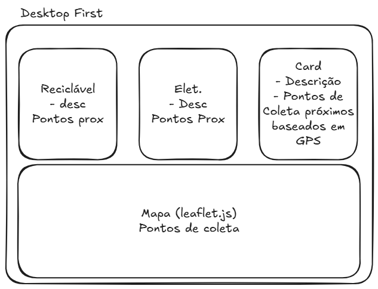
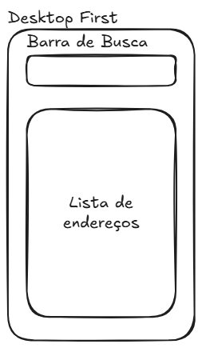
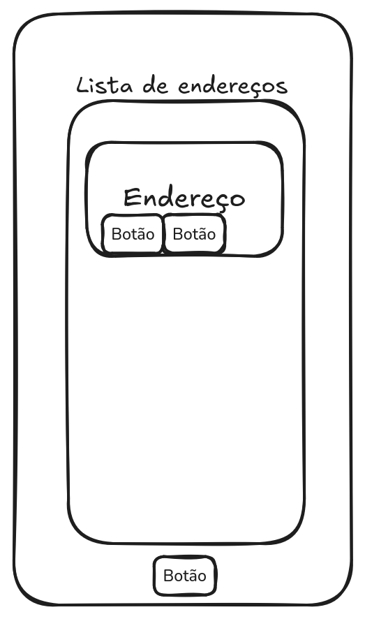

# Descartes-Seletivo
## Integrantes: 
- Enzo Benedetto Proença - RA: 10418579
- Livia Negrucci Cantowitz - RA: 10389419
- Victor Beltrame Sartos - RA: 10743709


## Explicação inicial sobre o processo de ideação
Conscientizar o público geral sobre reciclagem e descarte correto das diversas formas de lixo. Para isso, faremos uma página com duas características principais:
1. Cartões informativos com descrição do tipo do lixo e o ponto de coleta mais próximo.
2. Mapa com todos os pontos de coleta.
3. Página de locais favoritos, com botões para indicar o local no mapa.

Esse projeto tem por foco atender as ODS 11 (Cidades e comunidades sustentáveis) e 13 (Ação contra a mudança global do clima), em particular a 11.4 (Fortalecer esforços para proteger e salvaguardar o patrimônio cultural e natural do mundo) e 13.3 (Melhorar a educação, aumentar a conscientização e a capacidade humana e institucional sobre mitigação, adaptação, redução de impacto e alerta precoce da mudança do clima).

## Imagens do protótipo 




## Migração para Next.js

O site, que antes era feito com arquivos `.html` separados, foi migrado para o Next.js. A estrutura das páginas passou a ser escrita em JSX e dividida em componentes reutilizáveis, e o CSS foi movido para dentro da pasta `app`.

### 1. Layout raiz (`app/layout.js`)

O `layout.js` substitui o `<head>` e o `<body>` que se repetiam em todos os HTML. O conteúdo de cada página entra no lugar de `{children}`, o CSS global é importado aqui e o `<title>`/`<meta>` viraram o objeto `metadata`.

```javascript
import "./globals.css";

export const metadata = {
  title: "Create Next App",
  description: "Generated by create next app",
};

export default function RootLayout({ children }) {
  return (
    <html lang="en" className={`${geistSans.variable} ${geistMono.variable}`}>
      <body>{children}</body>
    </html>
  );
}
```

### 2. CSS global (`app/globals.css`)

O antigo `style.css` foi movido para `app/globals.css` sem mudanças nas regras. Os seletores por `id` e `class` continuam funcionando porque os componentes mantêm os mesmos `id` e `className` do HTML original.

```css
:root {
  --cor-primaria: #1b3a2f;
  --cor-destaque: #2e7d32;
  --fonte: Arial, sans-serif;
  /* ... */
}

#cards {
  display: flex;
  flex-wrap: wrap;
  justify-content: center;
  gap: 15px;
}
```

### 3. CSS Module da página (`app/page.module.css`)

O Next.js também suporta CSS Modules, arquivos `.module.css` cujas classes ficam restritas ao componente que os importa. O projeto tem o `page.module.css`, com variáveis próprias, regras responsivas e tema escuro.

```css
@media (max-width: 600px) {
  .main {
    padding: 48px 24px;
  }
}

@media (prefers-color-scheme: dark) {
  .page {
    --background: #000;
    --text-primary: #ededed;
  }
}
```

### 4. Página inicial (`app/page.js`)

O antigo `descartes.html` virou o `app/page.js`, servido na rota `/`. A página é montada juntando componentes, e os três cards, que antes eram blocos de HTML quase iguais, agora são o mesmo componente recebendo dados diferentes por **props**.

```javascript
<>
  <Header />
  <Navigation />

  <main>
    <p id="mensagem" aria-live="polite" />

    <section id="cards">
      <WasteCard
        id="reciclavel"
        titulo="Reciclável"
        descricao="Papel, plástico, vidro e metal. Separe e leve até um ecoponto."
        pontos={["Ecoponto Pinheiros", "Ecoponto Consolação"]}
      />
      {/* Eletrônico e Outros */}
    </section>

    <CollectionMap />
  </main>

  <footer />
</>
```

O `<>...</>` (*Fragment*) agrupa elementos sem criar uma `<div>` extra, e tags vazias precisam fechar com `/>`.

### 5. Componente `Header` (`src/components/Header.jsx`)

O `<header>` repetido em todas as páginas virou um componente que recebe o subtítulo pela prop `subtitle`.

```javascript
export default function Header({ subtitle }) {
  return (
    <header>
      <h1><span className="icone">♻️</span> Descartes Seletivo</h1>
      <p>{subtitle}</p>
    </header>
  );
}
```

### 6. Componente `Navigation` (`components/Navigation/index.js`)

Os `<a href="...html">` viraram `<Link>` do Next.js, que troca de página sem recarregar o site, e os links apontam para rotas (`/`, `/enderecos`, `/favoritos`). A classe `ativo` passou a ser aplicada pela prop `active`, e `class` virou `className`.

```javascript
<Link href="/enderecos" className={active === "enderecos" ? "ativo" : ""}>
  Buscar Endereços
</Link>
```

### 7. Componente `WasteCard` (`components/WasteCard/index.js`)

Cada `<article class="card">` virou o `WasteCard`. A função `mostrarPontos(tipo)` foi substituída pelo estado `visivel` (`useState`), e a lista só é renderizada quando ele é `true`. Os `<li>` agora são gerados com `map` a partir da prop `pontos`.

```javascript
const [visivel, setVisivel] = useState(false);

<button onClick={() => setVisivel((atual) => !atual)}>
  {visivel ? "Ocultar pontos de coleta" : "Ver pontos de coleta"}
</button>

{visivel && (
  <ul className="pontos" id={`pontos-${id}`}>
    {pontos.map((ponto) => <li key={ponto}>{ponto}</li>)}
  </ul>
)}
```

O `"use client"` no topo do arquivo indica que o componente roda no navegador, necessário por causa da interação.

### 8. Componente `CollectionMap` (`components/CollectionMap/index.js`)

O Leaflet saiu do CDN e passou a ser instalado pelo npm, com o CSS importado no próprio componente. Como ele depende do `window`, a biblioteca é importada dentro do `useEffect`, só no navegador, e o elemento do mapa é acessado por `useRef` no lugar de `getElementById`.

```javascript
useEffect(() => {
  let mapa;

  async function iniciarMapa() {
    const L = await import("leaflet");
    if (!mapaRef.current || mapaRef.current._leaflet_id) return;

    mapa = L.map(mapaRef.current).setView([-23.5505, -46.6333], 11);
    // camada do OpenStreetMap
  }

  iniciarMapa();
  return () => mapa?.remove();
}, []);
```

A checagem de `_leaflet_id` evita criar o mapa duas vezes, e o `mapa?.remove()` destrói o mapa quando o componente sai da tela.

### 9. Base de ecopontos (`src/data/enderecos.js`)

Os 132 ecopontos foram extraídos para um módulo compartilhado, que exporta a lista `ENDERECOS` e o centro inicial do mapa `CENTRO_SP`. Assim, a página de endereços e o mapa consultam a mesma fonte de dados.

```javascript
export const CENTRO_SP = [-23.5505, -46.6333];

export const ENDERECOS = [
  {
    "nome": "Jardim Romano",
    "endereco": "Rua Duarte Martins Mourão, 400 - Jardim Santa Margarida",
    "coords": [-23.4850264, -46.3857398]
  },
  // ...
];
```

```javascript
import { ENDERECOS } from "../../data/enderecos";
```

### 10. Página de endereços (`src/app/enderecos/page.js`)

O `enderecos.html` virou a rota `/enderecos`. A busca, os favoritos e a mensagem são estados (`useState`), e a filtragem usa `useMemo`. A busca continua acontecendo em `onChange()`, agora filtrando diretamente o array `ENDERECOS`.

```javascript
const resultados = useMemo(() => {
  if (!termo) return ENDERECOS;

  return ENDERECOS.filter((item) =>
    `${item.nome} ${item.endereco}`.toLowerCase().includes(termo)
  );
}, [termo]);
```

Os favoritos continuam salvos no `localStorage`, na chave `descartes:favoritos`, com as funções de leitura e gravação definidas na própria página. O botão alterna entre `☆` e `★`, recebe a classe `ativo` quando preenchido e expõe o estado com `aria-pressed`.

```javascript
<button
  type="button"
  className={`favorito${ehFavorito ? " ativo" : ""}`}
  title={rotulo}
  aria-label={rotulo}
  aria-pressed={ehFavorito}
  onClick={() => alternarFavorito(item)}
>
  {ehFavorito ? "★" : "☆"}
</button>
```

O botão “Ver no mapa” navega para a página inicial passando o nome do ecoponto:

```javascript
router.push(`/?ecoponto=${encodeURIComponent(nome)}`);
```

### 11. Página de favoritos (`src/app/favoritos/page.js`)

O `favoritos.html` virou a rota `/favoritos`, com toda a lógica de favoritos contida na própria página: carregar do `localStorage`, remover um item, limpar todos, calcular a contagem e controlar a mensagem.

```javascript
function carregarFavoritos() {
  try {
    const dados = JSON.parse(localStorage.getItem(CHAVE_FAVORITOS));
    return Array.isArray(dados) ? dados : [];
  } catch {
    return [];
  }
}

function salvarFavoritos(favoritos) {
  try {
    localStorage.setItem(CHAVE_FAVORITOS, JSON.stringify(favoritos));
    return true;
  } catch {
    return false;
  }
}
```

A lista é carregada no `useEffect` e os cards são gerados com `map`. O botão “Limpar todos” só aparece quando há favoritos salvos, e ecopontos sem coordenadas exibem um aviso e têm o botão de mapa desabilitado.

### 12. Mapa e seleção de ecoponto (`src/components/CollectionMap/index.jsx`)

O `CollectionMap` lê o parâmetro `?ecoponto=` da URL. Se o ponto existir e tiver coordenadas, o mapa centraliza nele e abre o popup; caso contrário, a mensagem informa que o ponto não tem coordenadas. Sem parâmetro, o componente tenta usar a geolocalização do navegador.

```javascript
const nome = new URLSearchParams(window.location.search).get("ecoponto");

if (nome) {
  colocarPin(L, nome);
  return;
}

centralizarNaMinhaPosicao(L);
```

```javascript
mapa.setView(item.coords, 16);
L.marker(item.coords)
  .addTo(mapa)
  .bindPopup(`<strong>${item.nome}</strong><br>${item.endereco}`)
  .openPopup();

onMessage?.(`Ponto exibido no mapa: ${item.nome}`);
```

## 11. API de ecopontos

Transformamos a lista em uma **API própria**: uma rota do Next.js que devolve os ecopontos em formato JSON. As páginas passaram a buscar os dados nessa rota usando `fetch`.

### 11.1 Criando a rota da API

No Next.js, um arquivo chamado `route.js` dentro da pasta `app` vira uma rota de API. O caminho das pastas define a URL:

```
src/app/api/enderecos/route.js  →  /api/enderecos
```

```js
import { ENDERECOS } from "@/data/enderecos";

export async function GET(request) {
  const { searchParams } = new URL(request.url);
  const nome = searchParams.get("nome")?.trim().toLowerCase();
  const busca = searchParams.get("busca")?.trim().toLowerCase();

  let resultado = ENDERECOS;

  if (nome) {
    resultado = resultado.filter((item) => item.nome.toLowerCase() === nome);
  }

  if (busca) {
    resultado = resultado.filter((item) =>
      `${item.nome} ${item.endereco}`.toLowerCase().includes(busca)
    );
  }

  return Response.json(resultado);
}
```

- A função `GET` é executada sempre que alguém acessa a URL.
- `searchParams` lê os filtros opcionais que vêm depois do `?` na URL.
- `Response.json(resultado)` devolve a lista em formato JSON.

A API aceita três formas de uso:

| URL | Resultado |
|---|---|
| `/api/enderecos` | todos os ecopontos |
| `/api/enderecos?busca=mooca` | ecopontos com "mooca" no nome ou endereço |
| `/api/enderecos?nome=Tatuapé` | um ecoponto específico pelo nome |

### 11.2 Página de endereços consumindo a API

Em `src/app/enderecos/page.js`, removemos o `import { ENDERECOS }` e criamos dois estados: um para guardar os ecopontos e outro para indicar se ainda estão carregando.

```js
const [enderecos, setEnderecos] = useState([]);
const [carregando, setCarregando] = useState(true);
```

Quando a página abre, o `useEffect` faz a requisição para a API:

```js
useEffect(() => {
  fetch("/api/enderecos")
    .then((res) => res.json())
    .then((dados) => setEnderecos(dados))
    .catch(() => setMensagem("Não foi possível carregar os ecopontos."))
    .finally(() => setCarregando(false));
}, []);
```

- `fetch` faz a requisição para a nossa API.
- `res.json()` transforma a resposta em um array JavaScript.
- `setEnderecos` guarda os dados no estado, e a lista aparece na tela.
- Se der erro, uma mensagem é exibida para o usuário.
- No final, `setCarregando(false)` indica que terminou de carregar.

Enquanto a API não responde, a contagem mostra um aviso de carregamento:

```jsx
{carregando
  ? "Carregando ecopontos..."
  : `Mostrando ${resultados.length} de ${enderecos.length} ecopontos`}
```

O filtro da busca continuou igual, só passou a usar `enderecos` (que vem da API) no lugar de `ENDERECOS`.

### 11.3 Mapa consumindo a API

No componente `CollectionMap`, a função `colocarPin` buscava o ecoponto direto na lista. Agora ela pede à API só o ecoponto que foi clicado, usando o filtro `nome`:

```js
async function colocarPin(L, nome) {
  let item;

  try {
    const res = await fetch(`/api/enderecos?nome=${encodeURIComponent(nome)}`);
    const dados = await res.json();
    item = dados[0];
  } catch {
    onMessage?.("Não foi possível carregar os ecopontos.");
    return;
  }

  if (cancelado || !mapa) return;
  // ...resto da função igual: centraliza o mapa e coloca o marcador
}
```

- A função virou `async` para poder usar `await` e esperar a resposta da API.
- `encodeURIComponent` protege nomes com acentos e espaços na URL (ex.: "Freguesia do Ó").
- `dados[0]` pega o primeiro (e único) resultado.
- `if (cancelado || !mapa) return;` evita erro caso o usuário saia da página antes da API responder.

### 11.4 Testando a API

Com o projeto rodando (`npm run dev`), basta abrir no navegador o endereço do site seguido de `/api/enderecos`. Se aparecer a lista em JSON, a API está funcionando.