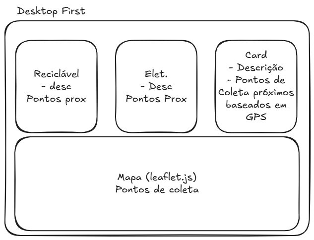
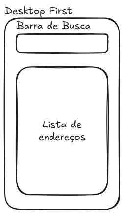
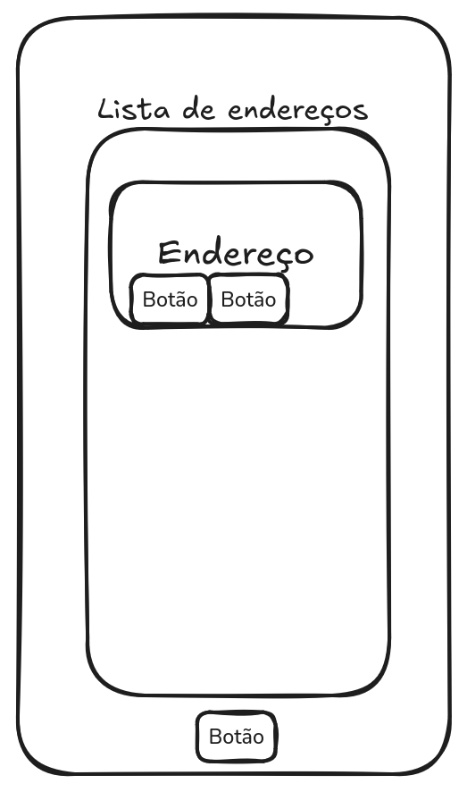

# Descartes-Seletivo
## Integrantes: 
- Enzo Benedetto Proença - RA: 10418579
- Livia Negrucci Cantowitz - RA: 10389419
- Victor Beltrame Sartos - RA: 10743709


## Explicação inicial sobre o processo de ideação
Conscientizar o público geral sobre reciclagem e descarte correto das diversas formas de lixo. Para isso, faremos uma página com duas características principais:
1. Cartões informativos com descrição do tipo do lixo e o ponto de coleta mais próximo.
2. Mapa com todos os pontos de coleta.
3. Página de locais favoritos, com botões para indicar o local no mapa.

Esse projeto tem por foco atender as ODS 11 (Cidades e comunidades sustentáveis) e 13 (Ação contra a mudança global do clima), em particular a 11.4 (Fortalecer esforços para proteger e salvaguardar o patrimônio cultural e natural do mundo) e 13.3 (Melhorar a educação, aumentar a conscientização e a capacidade humana e institucional sobre mitigação, adaptação, redução de impacto e alerta precoce da mudança do clima).

## Imagens do protótipo 




## Migração para Next.js

O site, que antes era feito com arquivos `.html` separados, foi migrado para o Next.js. A estrutura das páginas passou a ser escrita em JSX e dividida em componentes reutilizáveis, e o CSS foi movido para dentro da pasta `app`.

### 1. Layout raiz (`app/layout.js`)

O `layout.js` substitui o `<head>` e o `<body>` que se repetiam em todos os HTML. O conteúdo de cada página entra no lugar de `{children}`, o CSS global é importado aqui e o `<title>`/`<meta>` viraram o objeto `metadata`.

```javascript
import "./globals.css";

export const metadata = {
  title: "Create Next App",
  description: "Generated by create next app",
};

export default function RootLayout({ children }) {
  return (
    <html lang="en" className={`${geistSans.variable} ${geistMono.variable}`}>
      <body>{children}</body>
    </html>
  );
}
```

### 2. CSS global (`app/globals.css`)

O antigo `style.css` foi movido para `app/globals.css` sem mudanças nas regras. Os seletores por `id` e `class` continuam funcionando porque os componentes mantêm os mesmos `id` e `className` do HTML original.

```css
:root {
  --cor-primaria: #1b3a2f;
  --cor-destaque: #2e7d32;
  --fonte: Arial, sans-serif;
  /* ... */
}

#cards {
  display: flex;
  flex-wrap: wrap;
  justify-content: center;
  gap: 15px;
}
```

### 3. CSS Module da página (`app/page.module.css`)

O Next.js também suporta CSS Modules, arquivos `.module.css` cujas classes ficam restritas ao componente que os importa. O projeto tem o `page.module.css`, com variáveis próprias, regras responsivas e tema escuro.

```css
@media (max-width: 600px) {
  .main {
    padding: 48px 24px;
  }
}

@media (prefers-color-scheme: dark) {
  .page {
    --background: #000;
    --text-primary: #ededed;
  }
}
```

### 4. Página inicial (`app/page.js`)

O antigo `descartes.html` virou o `app/page.js`, servido na rota `/`. A página é montada juntando componentes, e os três cards, que antes eram blocos de HTML quase iguais, agora são o mesmo componente recebendo dados diferentes por **props**.

```javascript
<>
  <Header />
  <Navigation />

  <main>
    <p id="mensagem" aria-live="polite" />

    <section id="cards">
      <WasteCard
        id="reciclavel"
        titulo="Reciclável"
        descricao="Papel, plástico, vidro e metal. Separe e leve até um ecoponto."
        pontos={["Ecoponto Pinheiros", "Ecoponto Consolação"]}
      />
      {/* Eletrônico e Outros */}
    </section>

    <CollectionMap />
  </main>

  <footer />
</>
```

O `<>...</>` (*Fragment*) agrupa elementos sem criar uma `<div>` extra, e tags vazias precisam fechar com `/>`.

### 5. Componente `Header` (`src/components/Header.jsx`)

O `<header>` repetido em todas as páginas virou um componente que recebe o subtítulo pela prop `subtitle`.

```javascript
export default function Header({ subtitle }) {
  return (
    <header>
      <h1><span className="icone">♻️</span> Descartes Seletivo</h1>
      <p>{subtitle}</p>
    </header>
  );
}
```

### 6. Componente `Navigation` (`components/Navigation/index.js`)

Os `<a href="...html">` viraram `<Link>` do Next.js, que troca de página sem recarregar o site, e os links apontam para rotas (`/`, `/enderecos`, `/favoritos`). A classe `ativo` passou a ser aplicada pela prop `active`, e `class` virou `className`.

```javascript
<Link href="/enderecos" className={active === "enderecos" ? "ativo" : ""}>
  Buscar Endereços
</Link>
```

### 7. Componente `WasteCard` (`components/WasteCard/index.js`)

Cada `<article class="card">` virou o `WasteCard`. A função `mostrarPontos(tipo)` foi substituída pelo estado `visivel` (`useState`), e a lista só é renderizada quando ele é `true`. Os `<li>` agora são gerados com `map` a partir da prop `pontos`.

```javascript
const [visivel, setVisivel] = useState(false);

<button onClick={() => setVisivel((atual) => !atual)}>
  {visivel ? "Ocultar pontos de coleta" : "Ver pontos de coleta"}
</button>

{visivel && (
  <ul className="pontos" id={`pontos-${id}`}>
    {pontos.map((ponto) => <li key={ponto}>{ponto}</li>)}
  </ul>
)}
```

O `"use client"` no topo do arquivo indica que o componente roda no navegador, necessário por causa da interação.

### 8. Componente `CollectionMap` (`components/CollectionMap/index.js`)

O Leaflet saiu do CDN e passou a ser instalado pelo npm, com o CSS importado no próprio componente. Como ele depende do `window`, a biblioteca é importada dentro do `useEffect`, só no navegador, e o elemento do mapa é acessado por `useRef` no lugar de `getElementById`.

```javascript
useEffect(() => {
  let mapa;

  async function iniciarMapa() {
    const L = await import("leaflet");
    if (!mapaRef.current || mapaRef.current._leaflet_id) return;

    mapa = L.map(mapaRef.current).setView([-23.5505, -46.6333], 11);
    // camada do OpenStreetMap
  }

  iniciarMapa();
  return () => mapa?.remove();
}, []);
```

A checagem de `_leaflet_id` evita criar o mapa duas vezes, e o `mapa?.remove()` destrói o mapa quando o componente sai da tela.